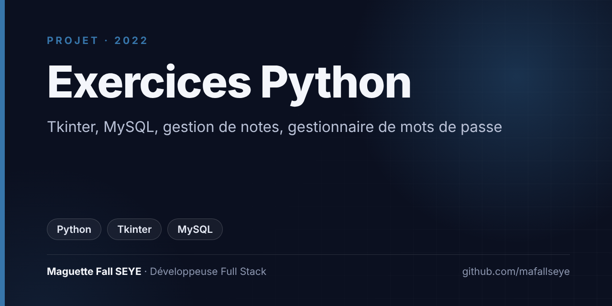

<p align="center"></p>

# Exercices Python

Exercices Python : interfaces Tkinter, MySQL, gestion de notes et gestionnaire de mots de passe.

## Fonctionnalités

- Interfaces graphiques Tkinter
- Gestion de notes d'élèves avec MySQL (`gestion/`)
- Petit gestionnaire de mots de passe

## Technologies

Python · Tkinter · MySQL

## Lancer le projet

Prérequis : Python 3.

```bash
git clone https://github.com/mafallseye/exopithon.git
cd exopithon
python <fichier>.py
```

> Projet réalisé en 2022 pendant ma formation. Il est conservé ici comme trace de mon parcours.

## Auteure

**Maguette Fall SEYE** — Développeuse Full Stack, Dakar (Sénégal) · [github.com/mafallseye](https://github.com/mafallseye)
